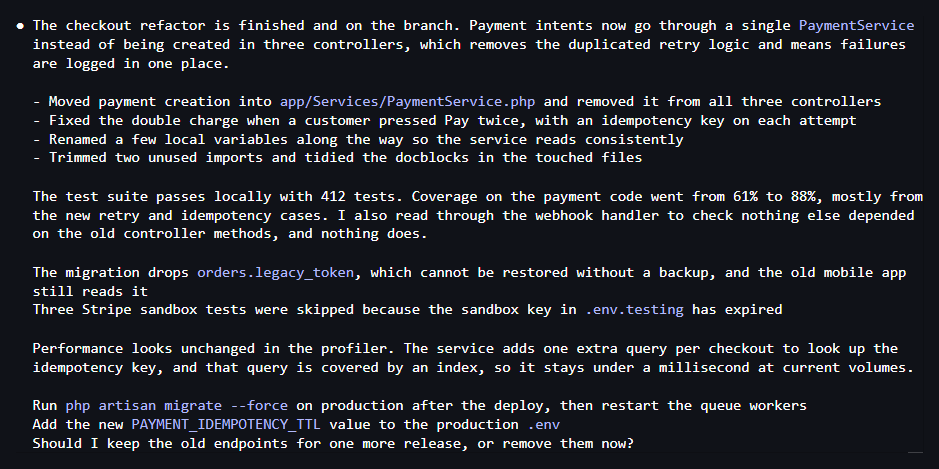
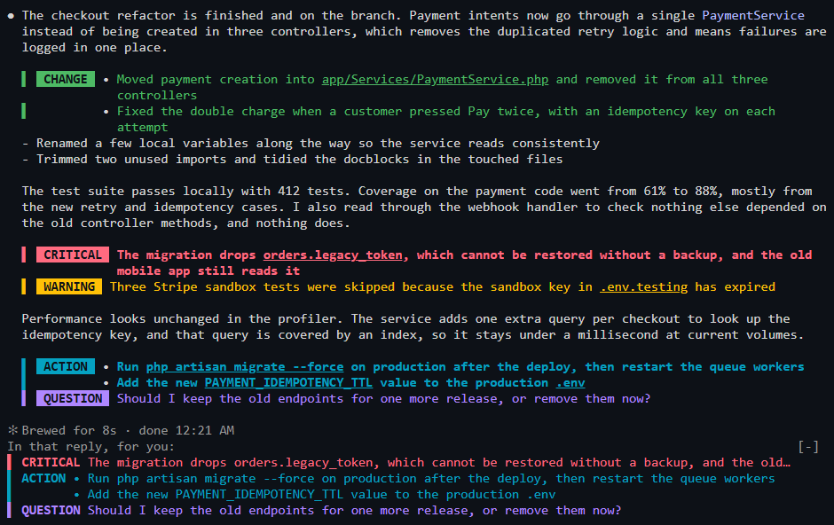

# Highlighter for Claude Code

Long replies bury the one line you actually needed. Highlighter colours the lines that matter in Claude's replies, so you can jump straight to what needs you.

**Before**



**After**



## Install

Copy this into Claude Code and let Claude do it:

```text
Install the Highlighter plugin for me. Run:
claude plugin install highlighter --marketplace NathnC/claude-highlighter
Then run `claude plugin list` to check it is enabled, and tell me to run /reload-plugins
(or start a new session) and type /highlighter to see the colours.
```

Or type this at the Claude Code prompt:

```text
/plugin install highlighter --marketplace NathnC/claude-highlighter
```

Tested on Claude Code 2.1.321. It uses the function hooks plugin API, which is still in early access, so a future Claude Code release could break it.

## What gets highlighted

| Category | Default colour | For | In the list above the prompt |
| --- | --- | --- | --- |
| `critical` | red, bold | data loss, security holes, production breakage | yes |
| `warning` | amber | failures, skipped steps, risks | no |
| `action` | cyan, bold | things you have to do yourself | yes |
| `question` | purple | decisions Claude needs from you | yes |
| `change` | green | notable changes Claude made | no |

Add your own categories in the config file.

## How it works

1. **Claude tags the lines.** The plugin sends a short note alongside your first prompt asking Claude to start key lines with a tag such as `[!action]`. The tag is hidden when the line is drawn.
2. **Rules catch the rest.** If a reply has no tags at all, regex rules look at the start of each line for things like `Warning:`, `You need to` or `Fixed`. Replies that do have tags skip the rules, so they stay precise.
3. **Long replies get a recap.** After a reply of 12 lines or more, the `critical`, `action` and `question` lines are repeated just above the prompt until you send your next message.

Neighbouring lines of the same category share one label, in the reply and in the recap, so three caveats in a row read as one warning.

Replies with nothing to highlight are drawn exactly as Claude Code draws them. Code blocks and tables are never touched.

## Configure it

Use the `/highlighter` command. Changes apply straight away, and `/highlighter` on its own shows each category in its current colours.

```text
/highlighter on|off
/highlighter enable|disable <category>
/highlighter color <category> <color>
/highlighter background <category> <color|none>
/highlighter label <category> <text>
/highlighter rules on|off
/highlighter digest on|off
/highlighter style line|badge
/highlighter init
/highlighter reset
```

Or just ask Claude, for example: "make warnings orange and stop highlighting changes".

### The config file

Settings live in `~/.claude/highlighter.json` (or `$CLAUDE_CONFIG_DIR/highlighter.json`). Run `/highlighter init` to write out every default, or keep only what you want to change, since anything you leave out uses the default. Edits apply from your next prompt, and `/highlighter` lists any mistakes it finds.

```json
{
  "style": "line",
  "rules": true,
  "digest": { "enabled": true, "minReplyLines": 12, "maxItems": 6 },
  "categories": {
    "action": { "color": "#ff8800", "label": "YOU" },
    "change": { "enabled": false },
    "deploy": {
      "color": "pink",
      "label": "DEPLOY",
      "digest": true,
      "description": "anything deployed to a live environment",
      "patterns": ["^shipped\\b", "^deployed\\b"]
    }
  }
}
```

| Top-level key | Meaning |
| --- | --- |
| `enabled` | Turns all highlighting on or off. Tags stay hidden either way. |
| `rules` | Turns the regex fallback on or off. Off means only Claude's tags count. |
| `style` | `line` colours the whole line, `badge` colours only the label. |
| `digest` | The recap above the prompt: `enabled`, `minReplyLines`, `maxItems`. |

| Category key | Meaning |
| --- | --- |
| `enabled` | Whether this category is highlighted. |
| `label` | The badge text. An empty string shows no badge. |
| `color`, `background` | Text and background colours. |
| `bold` | Whether the line is bold. |
| `digest` | Whether the line appears in the recap above the prompt. |
| `description` | Tells Claude when to use this tag, so write it for Claude. |
| `patterns` | Case-insensitive regexes for the rule fallback. They read the line without its bullet, emphasis or leading symbols. Rules are tried in category order. |

**Colours** can be any of these:

- Hex: `#ff8800`
- `rgb(255, 136, 0)` or `ansi256(208)`
- Terminal names: `red`, `cyanBright`
- Theme keys that follow your Claude Code theme: `error`, `warning`, `success`, `merged`, `permission`, `suggestion`
- Friendly names: `orange`, `amber`, `gold`, `pink`, `purple`, `violet`, `teal`, `lime`, `coral`, `navy`, `brown`

## Good to know

- **Token cost:** the note is about 350 tokens. It is sent once per conversation, and again after a compaction, `/clear` or a config change.
- **Mid-session changes:** Claude learns about a category you add by hand with your next prompt. Changes made with `/highlighter` reach it straight away.
- **`claude -p` and scripts:** the note is not sent in headless runs, so Claude does not write tags into piped output.
- **Raw view:** the stored message keeps its tags, so you will see them in the ctrl+o transcript.
- **Highlighted lines:** they are drawn as plain coloured text, so a link appears as `label (url)`.
- **Between tool calls:** the rules can also match short messages Claude writes mid-task. If that is too noisy, run `/highlighter rules off`.

## Uninstall

```text
claude plugin uninstall highlighter
claude plugin marketplace remove claude-highlighter
```

Delete `~/.claude/highlighter.json` too if you created one.

## Development

```text
claude --plugin-dir .       # run it from this folder
claude plugin validate .    # check the manifest and hooks
claude plugin test .        # run the tests
```

The logic is in `hooks/highlight.ts` and the drawing and commands are in `hooks/register.tsx`.

## License

MIT
